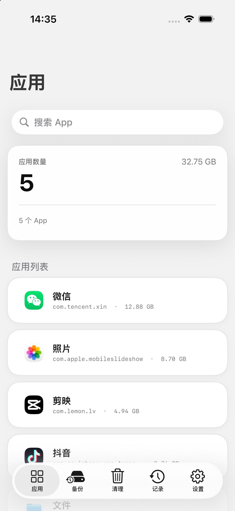
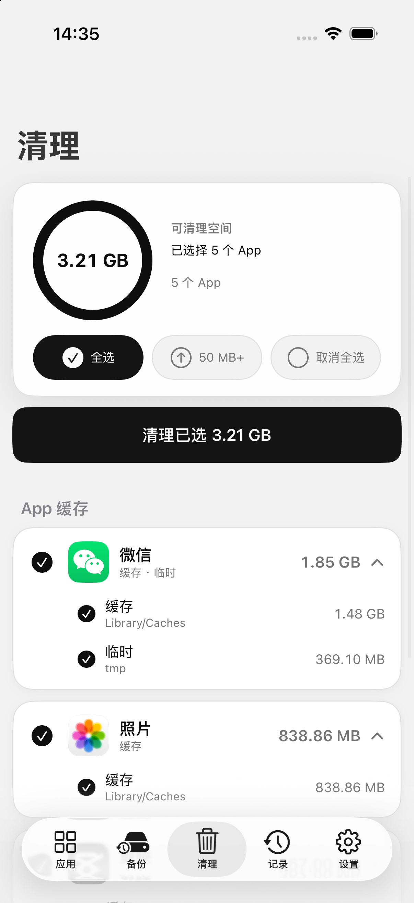
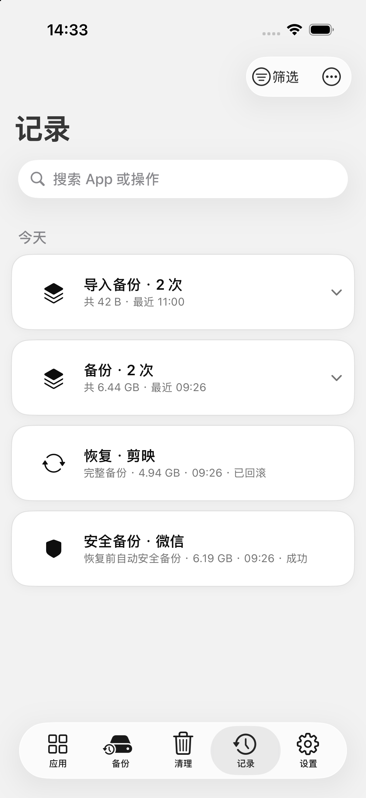
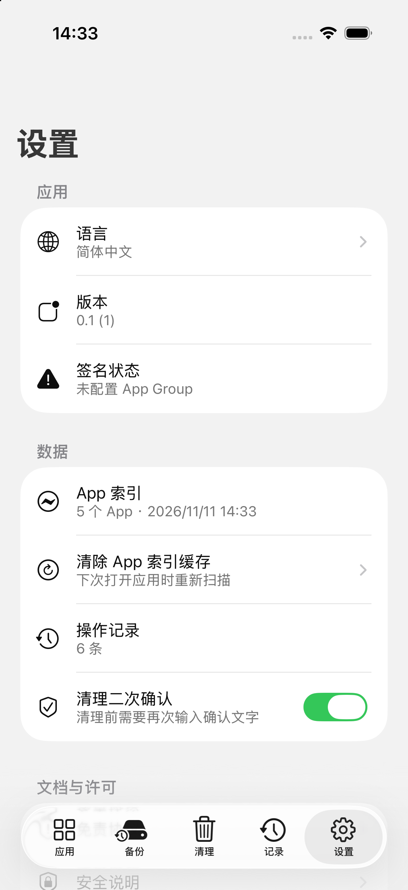

# WQManager

**An open-source iOS app data manager, backup tool and per-app cache cleaner for
iOS 26 and later — no jailbreak required.**

[简体中文](README.zh-Hans.md) · [Safety](SAFETY.md) · [Architecture](docs/ARCHITECTURE.md) · [Building](docs/BUILDING.md) · [FAQ](docs/FAQ.md)

> WQManager is not affiliated with Apple. iOS app data is private by design;
> this project only works because of a sandbox-extension technique published in
> [worse_query](https://github.com/forcequitOS/worse_query). Read
> [SAFETY.md](SAFETY.md) and [DISCLAIMER.md](DISCLAIMER.md) before using it on a
> device that holds data you care about.



## What it does

WQManager is built around three workflows:

1. **Back up** an app's data container (`Documents`, `Library`, optionally `tmp`)
   as a verifiable `.wqbackup` package.
2. **Restore** that package back into the same app, with an automatic safety
   backup, a recovery journal, post-write hash verification and rollback.
3. **Clean** only the selected app's `Library/Caches` and `tmp` directories,
   with per-directory selection and two-stage confirmation.

Everything is local. No account, no analytics, no cloud.

## Screenshots

| Applications | Cleaner |
|---|---|
|  |  |

| History | Settings |
|---|---|
|  |  |

## Features

### App overview

- Enumerates installed app data containers through an App Group container
  query, without reading the app bundles.
- Shows each app's data size, container identity status and limited-access
  warnings.
- Reads display names from the Launch Services store, with a built-in fallback
  table for common system apps.
- Resolves app icons from local sources when the system allows it, detects the
  generic grey placeholder that iOS returns for denied requests, and falls back
  to App Store artwork (iTunes Lookup) for store apps. See
  [Icons on stock iOS](#icons-on-stock-ios).

### Backup

- Quick backup: `Documents` + `Library`.
- Full backup: `Documents` + `Library` + `tmp`.
- Staged publication: data is copied to a temporary directory, verified, and
  only then moved into the backup store.
- Every part is content-hashed; the manifest records the app name, bundle ID,
  scope, iOS version, timestamps and per-part hashes.
- Backups can be exported as a `.wqbackup` package and imported again through
  the share sheet or Files.

### Restore

- Same-bundle-ID restore only (cross-app replacement is intentionally not
  implemented).
- Target app must be installed, closed, accessible and identity-verified.
- Automatic safety backup before writing.
- Recovery journal, post-write hash verification, immediate rollback on
  failure, and a manual crash-recovery path.

### Cache cleaner

- Cleans only `Library/Caches` and `tmp` inside the selected app's data
  container.
- Per-app, per-directory (cache / temporary) selection with a "clean selected"
  total.
- Container identity re-checked immediately before deletion.
- Two-stage confirmation (scope confirmation + typed confirmation), and the
  second stage can be turned off in Settings.
- Live cancellation and operation history.

### History

- Every backup, export, import, restore, rollback, cleanup and failure is
  recorded locally.
- Records are grouped by day and operation type; groups collapse into a single
  card and expand to per-item details.

### Interface

- Chinese (Simplified) and English, switchable in Settings.
- Light, high-contrast, large-type-friendly layout with Dynamic Type support.
- Legal gate, safety documentation and third-party credits built in.

## Icons on stock iOS

iOS does not let an unentitled third-party app ask IconServices for another
app's icon. On a stock device the system returns:

- `LaunchServices`: `-54 "process may not map database"`, and only a generic
  placeholder record for icon queries;
- `iconservicesagent`: `-609 "Client is disallowed from making such an icon
  request"`.

The only allowed requests are the client's own icon, first-party icons and
CoreType icons. WQManager therefore:

1. tries the local icon sources it is allowed to use;
2. fingerprints and rejects the generic grey placeholder (it is identical across
   apps, which is a reliable signal);
3. for App Store apps, fetches the official artwork from Apple's public iTunes
   Lookup API by bundle ID;
4. otherwise shows a letter tile.

This is why an app installed from a third-party signing service (no App Store
ID) may still show a letter tile: there is no legal local source and no public
artwork to fetch. This is a platform limitation, not a missing feature.

## Requirements

- Xcode 27.2 or later (iOS 26 SDK).
- iOS 26.0+ deployment target.
- A signing identity for device builds; the App Group entitlement
  `group.mumu.wqmanager` is required by both the app and the share extension.
- A paid Apple Developer account is needed for App Groups on physical devices.
  Free provisioning does not support App Groups and builds expire after 7 days.

## Build

```sh
DEVELOPER_DIR=/Applications/Xcode.app/Contents/Developer \
  xcodebuild \
  -project WQManager/WQManager.xcodeproj \
  -scheme WQManager \
  -configuration Debug \
  -sdk iphonesimulator \
  -destination 'generic/platform=iOS Simulator' \
  -derivedDataPath /tmp/WQManager-DerivedData \
  CODE_SIGNING_ALLOWED=NO \
  build
```

Then install the product on a booted simulator:

```sh
xcrun simctl install booted \
  /tmp/WQManager-DerivedData/Build/Products/Debug-iphonesimulator/WQManager.app
xcrun simctl launch booted mumu.pduola.WQManager
```

For device builds, signing, the App Group, the share extension and
troubleshooting, read [docs/BUILDING.md](docs/BUILDING.md).

## Tests

The portable safety and storage tests compile the relevant sources with `clang`
and run without a simulator or a device:

```sh
bash tests/run_tests.sh
```

Covered today: path safety and cleanup policy, backup store and manifest
validation, operation store persistence, backup archive/import validation.

## Project layout

```
WQManager/
  WQManager.xcodeproj/           JSON Xcode project
  WQManager/                     main app sources
    WQAccess.m                   App Group container queries + sandbox tokens
    WQLaunchServices.m           Launch Services display-name lookup
    WQMAppScanner.m              app enumeration and sizing
    WQMAppIconService.m          icon resolution, placeholder detection, remote fallback
    WQMBackupService.m           quick/full backup orchestration
    WQMBackupStore.m             backup store + manifest validation
    WQMRestoreService.m          restore, safety backup, rollback, recovery journal
    WQMBackupArchiveService.m    .wqbackup export/import
    WQMCacheService.m            cleaner scan + per-directory selection model
    WQMCleanerViewController.m   cleaner UI, confirmation flow
    WQMHistoryViewController.m   grouped operation history
    WQMSettingsViewController.m  settings, licenses, credits
    WQMCreditsViewController.m   third-party credits with avatars
    Base.lproj/, zh-Hans.lproj/, en.lproj/   storyboard + strings
  WQManagerShare/                share extension (.wqbackup inbox)
tests/run_tests.sh               portable C/Objective-C safety tests
docs/                            architecture, building, FAQ, screenshots
```

## How it works

The short version: an app's data container lives at
`/private/var/mobile/Containers/Data/Application/<UUID>`. A third-party process
cannot open it. WQManager uses the App Group container query API with the
`Library/Caches` path trick from `worse_query` to obtain a sandbox extension
token for that container, consumes the token, and then performs normal POSIX
I/O. Before any destructive operation it re-checks the container's device/inode,
canonical path and symlink ancestry.

See [docs/ARCHITECTURE.md](docs/ARCHITECTURE.md) for the full design, the backup
package format, the restore state machine and the threat model.

## Privacy

- No telemetry, no accounts, no servers operated by this project.
- App data never leaves the device except when you explicitly export a backup.
- The only network request is an iTunes Lookup query for public App Store
  artwork, and only for apps that need an icon; it can be disabled with
  `WQM_ICON_REMOTE=0` (see [docs/FAQ.md](docs/FAQ.md)).
- Operation history and diagnostic logs are stored locally inside the app
  container.

## Limitations

- **No jailbreak:** works through sandbox extensions, so it is limited to what
  those extensions allow. System data, system groups, daemons and SpringBoard
  caches are intentionally out of scope.
- **Same-bundle-ID restore only.** Cross-app replacement is not implemented.
- **Backups are not encrypted** by this app; rely on iOS file protection and
  your own encrypted storage for exports that contain sensitive data.
- **iOS 26+ only.** Older systems are not supported.
- **Icons:** see [Icons on stock iOS](#icons-on-stock-ios).
- The UI is optimized for iOS 26; behavior on future betas may change.

## Credits

WQManager would not exist without these projects and people. The in-app
credits screen lists them with avatars and links.

| | Author | Project | Contribution |
|---|---|---|---|
|  | [kolbicz](https://github.com/kolbicz) | [WQFiles](https://github.com/kolbicz/WQFiles) | Container access, container enumeration, Launch Services display-name lookup and filesystem safety helpers (GPL-3.0-or-later). |
|  | [Taj C (forcequitOS)](https://github.com/forcequitOS) | [worse_query](https://github.com/forcequitOS/worse_query) | The sandbox-extension technique that makes container access possible (GPL-3.0-or-later). |
|  | [murk-sus](https://github.com/murk-sus) | [KAMUI](https://github.com/murk-sus/kamui-escape) | Design reference for container enumeration with `fsgetpath`. |
|  | [huamidev](https://github.com/huamidev) | [GestaltX](https://github.com/huamidev) | Reference for the about page, licensing display and bilingual documentation. |

Apple frameworks used: UIKit, Foundation, LaunchServices (public APIs),
CoreUI/IconServices (private, only through `dlopen`-guarded runtime lookups),
UniformTypeIdentifiers, Security and System.

Full third-party license texts and notices: [THIRD_PARTY_NOTICES.md](THIRD_PARTY_NOTICES.md).

## Contributing

Issues and pull requests are welcome. Please read
[CONTRIBUTING.md](CONTRIBUTING.md) and [SECURITY.md](SECURITY.md) first, and run
`bash tests/run_tests.sh` before sending a change.

## License

WQManager is free software: you can redistribute it and/or modify it under the
terms of the **GNU General Public License, version 3 or later**. See
[LICENSE](LICENSE).

Because WQManager is derived from GPL-3.0-or-later code, any distributed fork
must remain GPL-3.0-or-later and keep the upstream notices.

## Disclaimer

Use at your own risk. This software deletes and overwrites app data by design.
Read [DISCLAIMER.md](DISCLAIMER.md) and [SAFETY.md](SAFETY.md) before using it.
