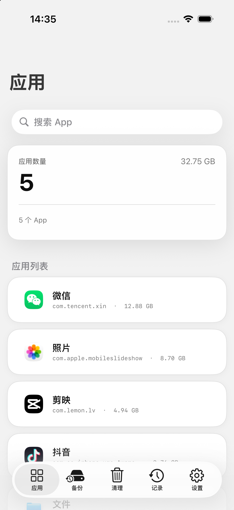
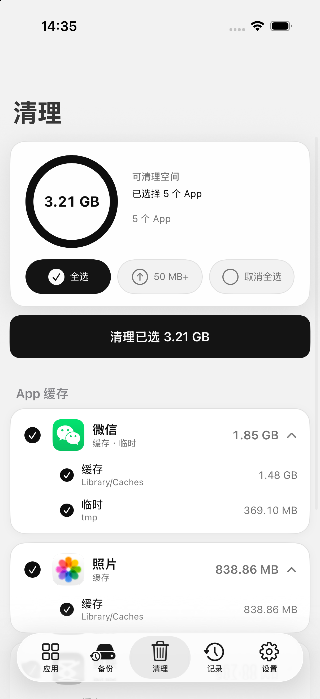
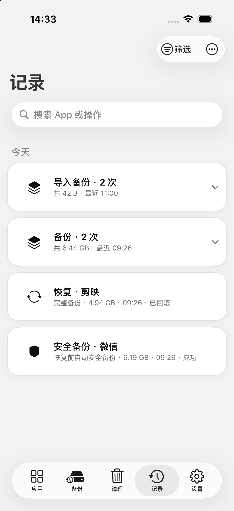
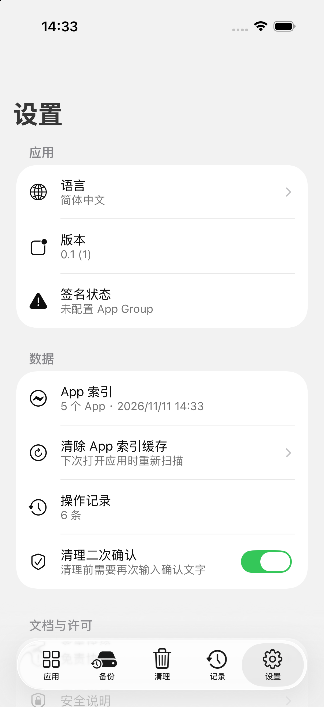

<h1 align="center">WQManager</h1>

<p align="center">
  
</p>

<p align="center">
  <strong>An open-source iOS app data manager, backup tool and per-app cache
  cleaner for iOS 26 and later — no jailbreak required.</strong>
</p>

<p align="center">
  <a href="https://github.com/hseons/WQManager">github.com/hseons/WQManager</a>
  &nbsp;·&nbsp;
  <a href="https://github.com/hseons/WQManager"> Give it a star if it helps～</a>
</p>

<p align="center">
  <a href="README.zh-Hans.md">简体中文</a> ·
  <a href="SAFETY.md">Safety</a> ·
  <a href="docs/ARCHITECTURE.md">Architecture</a> ·
  <a href="docs/BUILDING.md">Building</a> ·
  <a href="docs/FAQ.md">FAQ</a>
</p>

> WQManager is not affiliated with Apple. iOS app data is private by design;
> this project only works because of a sandbox-extension technique published in
> [worse_query](https://github.com/forcequitOS/worse_query). Read
> [SAFETY.md](SAFETY.md) and [DISCLAIMER.md](DISCLAIMER.md) before using it on a
> device that holds data you care about.

> Found a problem or have an idea? Please
> [open an issue](https://github.com/hseons/WQManager/issues) — feedback is
> welcome and helps make the app safer for everyone.

## What it does

WQManager is built around three workflows:

1. **Back up** an app's data container (`Documents`, `Library`, optionally `tmp`)
   as a verifiable `.wqbackup` package.
2. **Restore** that package back into the same app, with an automatic safety
   backup, a recovery journal, post-write hash verification and rollback.
3. **Clean** only the selected app's `Library/Caches` and `tmp` directories,
   with per-directory selection and two-stage confirmation.

Everything is local. No account, no analytics, no cloud.

## Screenshots

| Applications | Cleaner |
|---|---|
|  |  |

| History | Settings |
|---|---|
|  |  |

## Features

### App overview

- Enumerates installed app data containers through an App Group container
  query, without reading the app bundles.
- Shows each app's data size, container identity status and limited-access
  warnings.
- Reads display names from the Launch Services store, with a built-in fallback
  table for common system apps.
- Resolves app icons from local sources when the system allows it, detects the
  generic grey placeholder that iOS returns for denied requests, and falls back
  to App Store artwork (iTunes Lookup) for store apps. See
  [Icons on stock iOS](#icons-on-stock-ios).
- Filter by size and source, sort by scan order / name / size, and search by
  name, Bundle ID or pinyin initials. Filters and sort are remembered.

### Backup

- Quick backup: `Documents` + `Library`.
- Full backup: `Documents` + `Library` + `tmp`.
- Staged publication: data is copied to a temporary directory, verified, and
  only then moved into the backup store.
- Every part is content-hashed; the manifest records the app name, bundle ID,
  scope, iOS version, timestamps and per-part hashes.
- Backups can be exported as a `.wqbackup` package and imported again through
  the share sheet or Files.
- The list is grouped per app with per-group totals and a search field;
  optional retention (keep all / 1 / 3 / 5 / 10) trims old backups and never
  touches automatic safety backups.
- Load profiles: Standard, Automatic (backs off when the device gets hot) or
  Low-load, chosen in Settings. SHA-256, safety backups and rollback are kept
  in every profile.

### Restore

- Restores always target the same app (same Bundle ID).
- Target app must be installed, closed, accessible and identity-verified.
- Automatic safety backup before writing.
- Recovery journal, post-write hash verification, immediate rollback on
  failure, and a manual crash-recovery path.

### Cache cleaner

- Cleans only `Library/Caches` and `tmp` inside the selected app's data
  container.
- Per-app, per-directory (cache / temporary) selection with a "clean selected"
  total.
- Container identity re-checked immediately before deletion.
- Two-stage confirmation (scope confirmation + typed confirmation), and the
  second stage can be turned off in Settings.
- Live cancellation and operation history.

### Space Lens

- Browse an app container one level at a time as a bubble map: each child's
  area follows its size, so the biggest folders stand out at a glance.
- Drill into folders, jump anywhere from the breadcrumb, preview files, and
  switch to a precise list at any time.
- Preview images, JSON, text, video and audio in place; other binary formats fall
  back to a bounded hex dump. Text shows up to 64 KiB; full files can be shared.
- Select several items to export or delete, swipe a row to delete one, or
  long-press a bubble for preview, share, copy path or delete.
- Deletions land in a bin (Settings → Data) that can restore items to their
  original folder, remove them, or empty everything.

### File tools

- Large-file and duplicate audit across accessible apps, with type filters,
  SHA-256 verification and per-app duplicate groups. Duplicate cleanup keeps at
  least one copy per app and moves files to the Space Lens bin instead of
  deleting them outright.
- Export center: select files from any app, filter by type, then share the
  staged folder or save it through the system document picker. An export is
  only marked complete after the destination finishes; cancelling removes the
  staging tree.
- Global file search: search user files across every accessible app by file
  name, relative path or app name while results stream in. Filter by type and
  minimum size, sort by path/size/newest, preview in place or jump to the
  containing folder.
- File tools share a bounded catalog (50,000 files / 100,000 entries per app)
  and exclude `Library/Caches` and `tmp` unless a screen explicitly includes
  them.

### Space changes

- Rank apps by growth over the previous scan or the last 7/30 days, with a
  total occupied/net change footer and an all-app trend chart.
- Per-app detail shows current size, change since the previous scan and change
  over the last 7 days, plus the retained snapshot history.
- History keeps at most 60 snapshots; a changed container or a missing
  measurement starts a new series. Growth is not reclaimable space.

### History

- Every backup, export, import, restore, rollback, cleanup and failure is
  recorded locally.
- Export the whole record set as CSV for a spreadsheet or a bug report.
- Records are grouped by day and operation type; groups collapse into a single
  card and expand to per-item details.

### Interface

- Chinese (Simplified) and English, switchable in Settings.
- Light, high-contrast, large-type-friendly layout with Dynamic Type support.
- Legal gate, safety documentation and third-party credits built in.

## New in 0.5.0

- Global file search across accessible apps, with streaming results, type and
  size filters, path/size/newest sorting, previews and jump-to-folder.
- Storage changes now compare the previous scan or the last 7/30 days, add an
  all-app trend chart and a net-change summary, and keep the per-app history.
- File audit and export center: large-file and duplicate review, SHA-256
  duplicate confirmation per app, keep-one-per-app cleanup, and exports that
  can be shared or saved to Files and are recorded only after completion.
- Safety and consistency fixes: cross-app duplicate groups no longer imply a
  safe replacement, duplicate cleanup never selects the last copy in an app,
  export staging is cleaned on cancel/failure, and interrupted operations are
  shown as interrupted after relaunch.

## New workflows in 0.4.0

- Apps → App tools: storage changes (60 scan snapshots, growth ranking and per-app
  trends) and serial batch quick/full backups. Unknown sizes and changed containers
  start a new history series. Growth does not mean reclaimable space.
- App action sheet → Find files: filename/path search, size ranking, extension and
  minimum-size filters, previews and a jump to the containing folder. Indexing is
  bounded to 50,000 files / 100,000 entries; up to 1,000 results are shown and
  incomplete scans are labeled.
- Custom backups: browse and select up to 128 directories inside Documents,
  Library or tmp. Restore replaces only those directories, preserving siblings.
  Selecting only Documents may omit settings and sign-in state.
- Backup menu: notes, important-backup protection, content browsing and comparison.
  Protection survives export/import, excludes a backup from retention counts and
  must be removed before deletion. Protection is enforced by version 0.4.0 and later.
- Compare backups of the same app and directory scope using metadata, or request
  SHA-256 content comparison. Only regular files are compared, excluding empty
  directories, links and special files.
- Existing quick/full backups retain format 2. Custom backups use format 3 and
  require WQManager 0.4.0 or later to import.
- Stopping a batch finishes its active backup first. Keep the app in the foreground;
  backgrounding pauses subsequent jobs. Saved pending/interrupted jobs can be
  resumed explicitly after reopening, using refreshed container identities.

### History badges and empty states (0.4, build 16)

- History status badges keep their full width; when space is tight the secondary
  line wraps or truncates instead, so 成功/已回滚 are never clipped to one character.
  Secondary text is limited to two lines.
- A stale app index now shows "· 下拉可重试" in the warning colour, so a failed
  refresh no longer looks like a neutral caption.
- 清理 hides the selection count and quick filters when nothing is eligible, and
  tapping the empty card starts a new scan.
- Backup rows read 今天/昨天/date plus the time, which makes several backups of the
  same app easier to tell apart.

### Performance and inspection (0.4, build 15)

- App scans publish results progressively; App actions → Refresh this app updates
  one measurement after checking identity, without adding a whole-scan history sample.
- File search filters a sorted index on a worker queue after a 180 ms debounce.
  Text/JSON reads and thumbnail decoding also run off the main thread; image
  previews are capped at 4096 pixels.
- Open `.plist`, `.db`, `.sqlite` or `.sqlite3` from file preview to make a private
  working copy. Close the source app first. Binary/XML plist trees show 200 items
  per page; SQLite exposes ordinary tables, schema and 100-row pages.
- Limits: plist 8 MiB; database + WAL 512 MiB; values 4 KiB, BLOB size summaries.
  Export one selected table as CSV, up to 10,000 rows / 16 MiB using those same
  value bounds. Changing inputs and active rollback journals stop inspection;
  partial CSV exports are removed. Source databases are never opened by SQLite.
- Access diagnostics are also available from App actions and backup/restore errors.
- GitHub Actions runs configuration checks, portable tests and simulator UI flows.

See [the next WQ capability plan](docs/NEXT_STEPS_WQ.md) for future research.

### Access diagnostics (0.4, build 14)

Settings → Access capabilities shows runtime App Group signing evidence, the
device and exact OS build. Choose one app from the existing index to check the
token stage, container identity, directory opens/listings and file-read samples.
Failures suggest refreshing the index, preserving App Groups when re-signing,
or exporting a report for investigation.

Each directory checks at most 64 direct entries. Documents, Library and tmp
each attempt a read of up to one byte from one regular file. Empty directories
leave file reads untested; successful samples do not establish full-container
access. Shared App Groups, extensions, system containers and writes remain
untested. The existing WQ grant flow temporarily uses the tool's own App Group
cache; diagnostics do not write to the target app or start a full-disk scan.

The share button exports a local JSON report with environment evidence, failure
stages and numeric error codes, excluding app names, bundle IDs, paths, tokens,
raw logs and file contents. Simulator and synthetic samples are explicitly
marked. The displayed version is 0.5, build 1; release revisions remain
available for tags and update checks.

## Icons on stock iOS

iOS does not let an unentitled third-party app ask IconServices for another
app's icon. On a stock device the system returns:

- `LaunchServices`: `-54 "process may not map database"`, and only a generic
  placeholder record for icon queries;
- `iconservicesagent`: `-609 "Client is disallowed from making such an icon
  request"`.

The only allowed requests are the client's own icon, first-party icons and
CoreType icons. WQManager therefore:

1. tries the local icon sources it is allowed to use;
2. fingerprints and rejects the generic grey placeholder (it is identical across
   apps, which is a reliable signal);
3. for App Store apps, fetches the official artwork from Apple's public iTunes
   Lookup API by bundle ID;
4. otherwise shows a letter tile.

So an app installed through a third-party signing service (no App Store ID) can
still show a letter tile: there is no local icon we are allowed to read and no
public artwork to fetch.

## Requirements

- Xcode 27.2 or later (iOS 26 SDK).
- iOS 26.0+ deployment target.
- A signing identity for device builds; the App Group entitlement
  `group.mumu.wqmanager` is required by both the app and the share extension.
- A paid Apple Developer account is needed for App Groups on physical devices.
  Free provisioning does not support App Groups and builds expire after 7 days.

## Build

```sh
DEVELOPER_DIR=/Applications/Xcode.app/Contents/Developer \
  xcodebuild \
  -project WQManager/WQManager.xcodeproj \
  -scheme WQManager \
  -configuration Debug \
  -sdk iphonesimulator \
  -destination 'generic/platform=iOS Simulator' \
  -derivedDataPath /tmp/WQManager-DerivedData \
  CODE_SIGNING_ALLOWED=NO \
  build
```

Then install the product on a booted simulator:

```sh
xcrun simctl install booted \
  /tmp/WQManager-DerivedData/Build/Products/Debug-iphonesimulator/WQManager.app
xcrun simctl launch booted mumu.pduola.WQManager
```

For device builds, signing, the App Group, the share extension and
troubleshooting, read [docs/BUILDING.md](docs/BUILDING.md).

## Tests

The portable safety and storage tests compile the relevant sources with `clang`
and run without a simulator or a device:

```sh
bash tests/run_tests.sh
```

Covered today: path safety and cleanup policy, backup store and manifest
validation, operation store persistence, backup archive/import validation.

## Project layout

```
WQManager/
  WQManager.xcodeproj/           JSON Xcode project
  WQManager/                     main app sources
    WQAccess.m                   App Group container queries + sandbox tokens
    WQLaunchServices.m           Launch Services display-name lookup
    WQMAppScanner.m              app enumeration and sizing
    WQMAppIconService.m          icon resolution, placeholder detection, remote fallback
    WQMBackupService.m           quick/full backup orchestration
    WQMBackupStore.m             backup store + manifest validation
    WQMRestoreService.m          restore, safety backup, rollback, recovery journal
    WQMBackupArchiveService.m    .wqbackup export/import
    WQMCacheService.m            cleaner scan + per-directory selection model
    WQMCleanerViewController.m   cleaner UI, confirmation flow
    WQMHistoryViewController.m   grouped operation history
    WQMSettingsViewController.m  settings, licenses, credits
    WQMCreditsViewController.m   third-party credits with avatars
    Base.lproj/, zh-Hans.lproj/, en.lproj/   storyboard + strings
  WQManagerShare/                share extension (.wqbackup inbox)
tests/run_tests.sh               portable C/Objective-C safety tests
docs/                            architecture, building, FAQ, screenshots
```

## How it works

The short version: an app's data container lives at
`/private/var/mobile/Containers/Data/Application/<UUID>`. A third-party process
cannot open it. WQManager uses the App Group container query API with the
`Library/Caches` path trick from `worse_query` to obtain a sandbox extension
token for that container, consumes the token, and then performs normal POSIX
I/O. Before any destructive operation it re-checks the container's device/inode,
canonical path and symlink ancestry.

See [docs/ARCHITECTURE.md](docs/ARCHITECTURE.md) for the full design, the backup
package format, the restore state machine and the threat model.

## Privacy

- No telemetry, no accounts, no servers operated by this project.
- App data never leaves the device except when you explicitly export a backup.
- The only network request is an iTunes Lookup query for public App Store
  artwork, and only for apps that need an icon; it can be disabled with
  `WQM_ICON_REMOTE=0` (see [docs/FAQ.md](docs/FAQ.md)).
- Operation history and diagnostic logs are stored locally inside the app
  container.

## Limitations

- iOS 26 or later.
- Without a jailbreak, WQManager reaches app data containers through sandbox
  extensions only. System directories, other apps' bundles and SpringBoard
  caches are out of reach.
- Restore writes back to the same app (same Bundle ID). Copying data from one
  app into another is not supported.
- Backups are plain directories and are not encrypted. For sensitive data, rely
  on iOS file protection or encrypt the archive yourself.
- Third-party icons depend on system policy; see
  [Icons on stock iOS](#icons-on-stock-ios).
- The interface is designed for iOS 26; later releases may behave differently.

## Credits

WQManager would not exist without these projects and people.

| | Author | Project | Contribution |
|---|---|---|---|
|  | [kolbicz](https://github.com/kolbicz) | [WQFiles](https://github.com/kolbicz/WQFiles) | Container access, container enumeration, Launch Services display-name lookup and filesystem safety helpers (GPL-3.0-or-later). |
|  | [Taj C (forcequitOS)](https://github.com/forcequitOS) | [worse_query](https://github.com/forcequitOS/worse_query) | The sandbox-extension technique that makes container access possible (GPL-3.0-or-later). |
|  | [murk-sus](https://github.com/murk-sus) | [KAMUI](https://github.com/murk-sus/kamui-escape) | Design reference for container enumeration with `fsgetpath`. |
|  | [huamidev](https://github.com/huamidev) | [GestaltX](https://github.com/huamidev) | Reference for the about page, licensing display and bilingual documentation. |

Apple frameworks used: UIKit, Foundation, LaunchServices (public APIs),
CoreUI/IconServices (private, only through `dlopen`-guarded runtime lookups),
UniformTypeIdentifiers, Security and System.

Full third-party license texts and notices: [THIRD_PARTY_NOTICES.md](THIRD_PARTY_NOTICES.md).

## Contributing

Issues and pull requests are welcome. Please read
[CONTRIBUTING.md](CONTRIBUTING.md) and [SECURITY.md](SECURITY.md) first, and run
`bash tests/run_tests.sh` before sending a change.

## License

WQManager is free software: you can redistribute it and/or modify it under the
terms of the **GNU General Public License, version 3 or later**. See
[LICENSE](LICENSE).

Because WQManager is derived from GPL-3.0-or-later code, any distributed fork
must remain GPL-3.0-or-later and keep the upstream notices.

## Disclaimer

Use at your own risk. This software deletes and overwrites app data by design.
Read [DISCLAIMER.md](DISCLAIMER.md) and [SAFETY.md](SAFETY.md) before using it.
