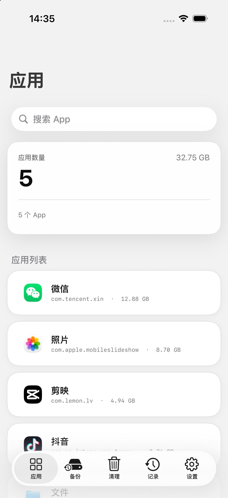
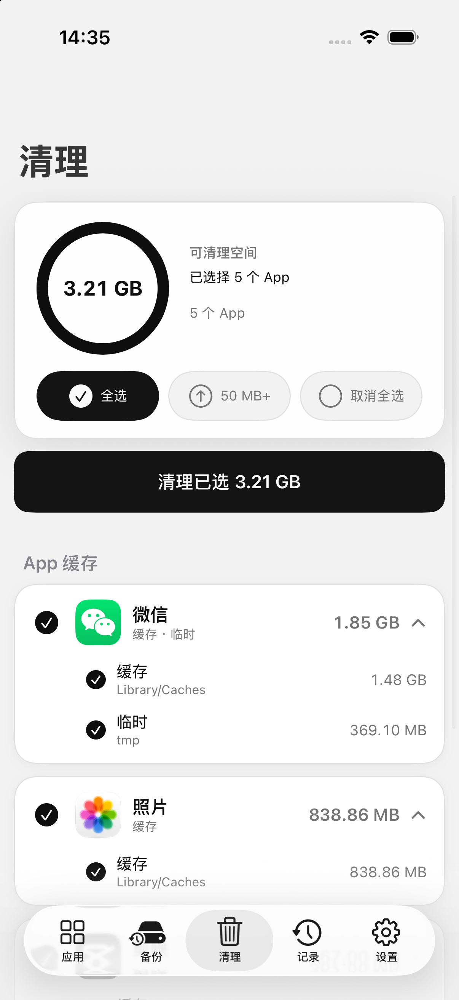
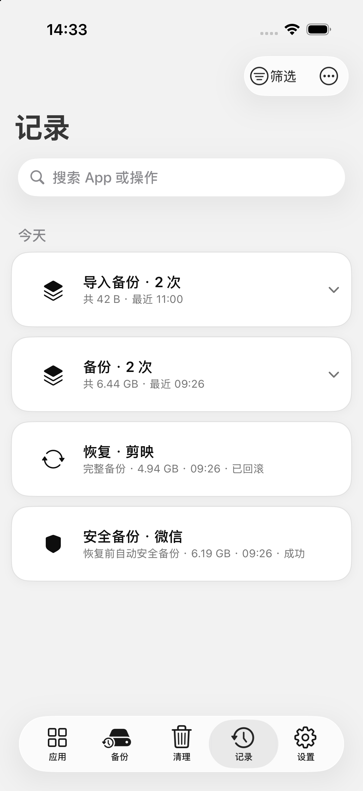
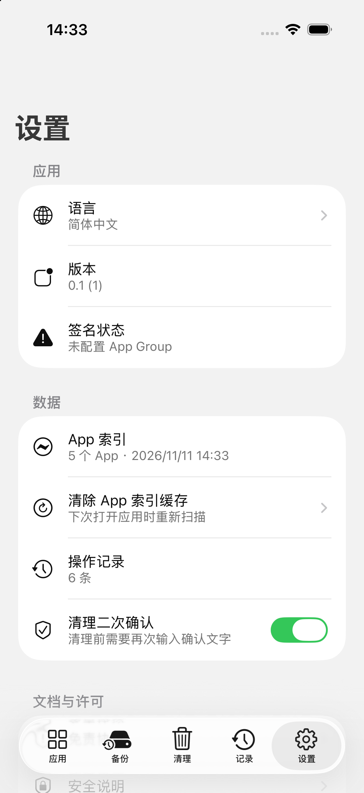

<h1 align="center">WQManager</h1>

<p align="center">
  
</p>

<p align="center">
  <strong>一款面向 iOS 26+ 的开源 App 数据管理、备份与单应用缓存清理工具，无需越狱。</strong>
</p>

<p align="center">
  <a href="https://github.com/hseons/WQManager">github.com/hseons/WQManager</a>
  &nbsp;·&nbsp;
  <a href="https://github.com/hseons/WQManager"> 给个 star 吧～</a>
</p>

<p align="center">
  <a href="README.md">English</a> ·
  <a href="SAFETY.md">安全说明</a> ·
  <a href="docs/ARCHITECTURE.md">架构</a> ·
  <a href="docs/BUILDING.md">构建</a> ·
  <a href="docs/FAQ.md">常见问题</a>
</p>

> WQManager 与 Apple 无关。iOS 的 App 数据天然隔离，本项目能工作完全依赖
> [worse_query](https://github.com/forcequitOS/worse_query) 公开的沙盒扩展技巧。
> 在存有重要数据的设备上使用前，请先读 [SAFETY.md](SAFETY.md) 与
> [DISCLAIMER.md](DISCLAIMER.md)。

## 能做什么

WQManager 围绕三条工作流设计：

1. **备份**：把某个 App 的数据目录（`Documents`、`Library`，可选 `tmp`）打包成
   可校验的 `.wqbackup` 备份包。
2. **恢复**：把备份写回同一个 App，写前自动做安全备份，带恢复日志、写后哈希
   校验和失败回滚。
3. **清理**：只清理所选 App 的 `Library/Caches` 与 `tmp`，支持按目录单独勾选
   和二次确认。

所有数据都在本机处理，没有账号、没有统计、没有云端。

## 截图

| 应用 | 清理 |
|---|---|
|  |  |

| 记录 | 设置 |
|---|---|
|  |  |

## 功能

### 应用总览

- 通过 App Group 容器查询枚举已安装 App 的数据容器，全程不读 App 包。
- 显示每个 App 的数据大小、容器身份状态和受限提示。
- 从 Launch Services 读取显示名称，内置常见系统 App 的名称兜底。
- 图标优先本地解析；识别 iOS 在拒绝请求时返回的灰色通用占位图；App Store
  应用回退到 iTunes Lookup 获取公开图标。详见
  [关于图标](#关于图标未越狱真机)。

### 备份

- 快速备份：`Documents` + `Library`。
- 完整备份：额外包含 `tmp`。
- 分阶段发布：先写临时目录并校验，成功后才移入备份仓库。
- 每个部分都有内容哈希；manifest 记录 App 名、Bundle ID、范围、iOS 版本、
  时间与各部分的哈希。
- 备份可导出为 `.wqbackup` 包，也可通过分享面板 / 文件 App 重新导入。

### 恢复

- 恢复只写回同一个 App（同 Bundle ID），不会把数据搬到别的 App。
- 目标 App 必须已安装、已关闭、可访问且身份校验通过。
- 写入前自动执行安全备份。
- 恢复日志、写后哈希校验、失败立即回滚，以及崩溃后的手动恢复入口。

### 清理

- 只清理所选 App 数据容器内的 `Library/Caches` 与 `tmp`。
- 按 App、按目录（缓存 / 临时）单独勾选，顶部实时显示「清理已选 X」。
- 删除前再次核对容器身份。
- 两段式确认（范围确认 + 输入确认），第二段可在设置里关闭。
- 支持中途取消，并写入操作记录。

### 记录

- 备份、导出、导入、恢复、回滚、清理、失败都会记录在本机。
- 按「天 + 操作类型」分组，默认折叠成一张卡，展开后显示每条明细。

### 界面

- 简体中文 / English，可在设置中切换，默认简体中文。
- 高对比度、支持动态字体（Dynamic Type）与辅助功能大字号。
- 内置法律确认页、安全说明与第三方致谢页。

## 关于图标（未越狱真机）

iOS 不允许没有对应 entitlement 的第三方 App 向 IconServices 请求别的 App 的
图标。在未越狱设备上，系统会直接拒绝：

- `LaunchServices`：`-54 "process may not map database"`，图标查询只会返回
  通用占位记录；
- `iconservicesagent`：`-609 "Client is disallowed from making such an icon
  request"`。

系统只允许「自己的图标 / 第一方图标 / CoreType 图标」。因此 WQManager：

1. 先尝试系统允许的本地来源；
2. 对返回的图片做指纹识别，丢弃所有 App 都一样的灰色占位图；
3. App Store 应用通过 Apple 公开的 iTunes Lookup 按 Bundle ID 取官方图标；
4. 其余情况显示首字母占位块。

所以，通过第三方签名工具安装、没有 App Store ID 的 App 仍可能只显示字母块：
既没有我们能读取的本地图标，也没有可查询的公开图标。

## 环境要求

- Xcode 27.2 或更高（iOS 26 SDK）。
- 部署目标 iOS 26.0+。
- 真机构建需要签名身份，App 与分享扩展都需要 App Group
  `group.mumu.wqmanager`。
- 真机使用 App Group 需要付费 Apple Developer 账号；免费证书不支持 App
  Group，且构建 7 天后过期。

## 构建

```sh
DEVELOPER_DIR=/Applications/Xcode.app/Contents/Developer \
  xcodebuild \
  -project WQManager/WQManager.xcodeproj \
  -scheme WQManager \
  -configuration Debug \
  -sdk iphonesimulator \
  -destination 'generic/platform=iOS Simulator' \
  -derivedDataPath /tmp/WQManager-DerivedData \
  CODE_SIGNING_ALLOWED=NO \
  build
```

安装到已启动的模拟器：

```sh
xcrun simctl install booted \
  /tmp/WQManager-DerivedData/Build/Products/Debug-iphonesimulator/WQManager.app
xcrun simctl launch booted mumu.pduola.WQManager
```

真机签名、App Group、分享扩展与常见构建问题见
[docs/BUILDING.md](docs/BUILDING.md)。

## 测试

安全与存储相关的可移植测试直接用 `clang` 编译源码运行，不需要模拟器或真机：

```sh
bash tests/run_tests.sh
```

目前覆盖：路径安全与清理策略、备份仓库与 manifest 校验、操作记录持久化、
备份导入导出校验。

## 目录结构

```
WQManager/
  WQManager.xcodeproj/           JSON 格式 Xcode 工程
  WQManager/                     主 App 源码
    WQAccess.m                   App Group 容器查询 + 沙盒 token
    WQLaunchServices.m           Launch Services 显示名查询
    WQMAppScanner.m              App 枚举与大小统计
    WQMAppIconService.m          图标解析、占位图识别、联网回退
    WQMBackupService.m           快速/完整备份编排
    WQMBackupStore.m             备份仓库与 manifest 校验
    WQMRestoreService.m          恢复、安全备份、回滚、恢复日志
    WQMBackupArchiveService.m    .wqbackup 导入/导出
    WQMCacheService.m            清理扫描与按目录选择模型
    WQMCleanerViewController.m   清理界面与确认流程
    WQMHistoryViewController.m   分组操作记录
    WQMSettingsViewController.m  设置、许可、致谢
    WQMCreditsViewController.m   第三方致谢（含头像）
    Base.lproj/, zh-Hans.lproj/, en.lproj/   界面与文案
  WQManagerShare/                分享扩展（.wqbackup 收件箱）
tests/run_tests.sh               可移植的安全测试
docs/                            架构、构建、FAQ、截图
```

## 工作原理

简述：App 数据容器位于
`/private/var/mobile/Containers/Data/Application/<UUID>`，普通第三方进程无法
打开。WQManager 通过 App Group 容器查询 API 与 `worse_query` 的
`Library/Caches` 路径技巧，取得该容器的 sandbox extension token，消费 token
后即可进行普通 POSIX 读写。执行任何破坏性操作前，会重新核对容器的
device/inode、规范路径和符号链接祖先链。

完整设计、备份包格式、恢复状态机与威胁模型见
[docs/ARCHITECTURE.md](docs/ARCHITECTURE.md)。

## 隐私

- 没有统计、没有账号、没有本项目运营的服务器。
- App 数据不会离开设备，除非你主动导出备份。
- 唯一的网络请求是按 Bundle ID 查询 Apple 公开的 App Store 图标接口；可用
  环境变量 `WQM_ICON_REMOTE=0` 关闭（见 [docs/FAQ.md](docs/FAQ.md)）。
- 操作记录与诊断日志都保存在 App 容器内。

## 已知限制

- 只支持 iOS 26 及以上。
- 未越狱时，只能通过 sandbox extension 访问 App 自己的数据目录；系统目录、
  其他 App 的包体和 SpringBoard 缓存都够不到。
- 恢复只写回同一个 App（同 Bundle ID），不支持把 A 的数据放进 B。
- 备份包是明文目录，不加密；敏感数据建议放在受 iOS 文件保护的位置，或自己加密后再保存。
- 第三方 App 图标受系统限制，详见[关于图标](#关于图标未越狱真机)。
- 界面按 iOS 26 设计，后续系统版本上可能出现差异。

## 致谢

没有这些项目和人，就没有 WQManager。

| | 作者 | 项目 | 贡献 |
|---|---|---|---|
|  | [kolbicz](https://github.com/kolbicz) | [WQFiles](https://github.com/kolbicz/WQFiles) | 容器访问、容器枚举、Launch Services 显示名查询与文件系统安全辅助（GPL-3.0-or-later）。 |
|  | [Taj C (forcequitOS)](https://github.com/forcequitOS) | [worse_query](https://github.com/forcequitOS/worse_query) | 让容器访问成为可能的沙盒扩展技术（GPL-3.0-or-later）。 |
|  | [murk-sus](https://github.com/murk-sus) | [KAMUI](https://github.com/murk-sus/kamui-escape) | 使用 `fsgetpath` 枚举容器的实现参考。 |
|  | [huamidev](https://github.com/huamidev) | [GestaltX](https://github.com/huamidev) | 关于页、许可展示与双语文档的参考。 |

使用的 Apple 框架：UIKit、Foundation、LaunchServices（公开 API）、
CoreUI/IconServices（私有，经 `dlopen` 保护后运行时查找）、
UniformTypeIdentifiers、Security、System。

完整第三方许可文本：[THIRD_PARTY_NOTICES.md](THIRD_PARTY_NOTICES.md)。

## 参与贡献

欢迎提 Issue 与 Pull Request。请先阅读 [CONTRIBUTING.md](CONTRIBUTING.md) 与
[SECURITY.md](SECURITY.md)，并在提交前运行 `bash tests/run_tests.sh`。

## 许可证

WQManager 是自由软件，按 **GNU General Public License v3.0 or later** 发布。
见 [LICENSE](LICENSE)。

由于本项目包含 GPL-3.0-or-later 的衍生代码，任何分发版本都必须继续使用
GPL-3.0-or-later 并保留上游声明。

## 免责声明

请自行承担使用风险。本软件按设计会删除和覆盖 App 数据。使用前请阅读
[DISCLAIMER.md](DISCLAIMER.md) 与 [SAFETY.md](SAFETY.md)。
